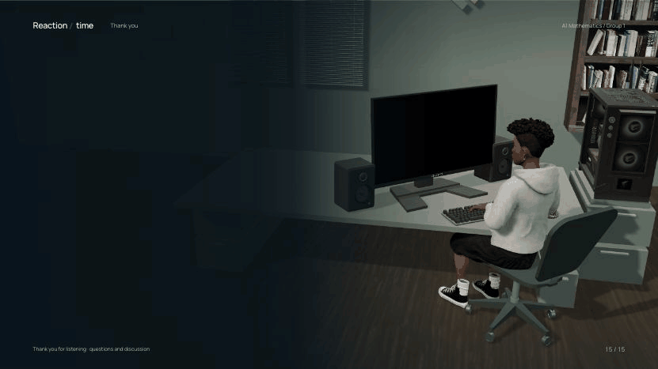
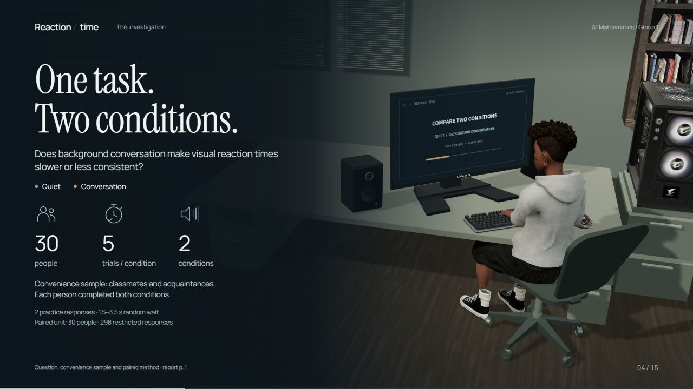
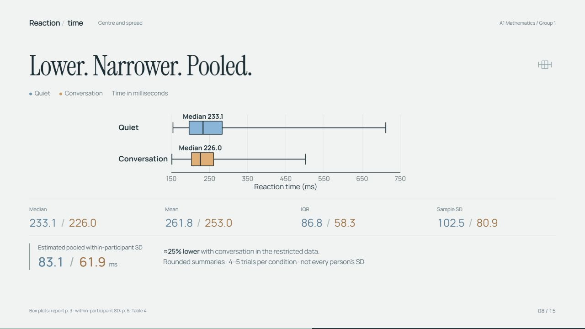
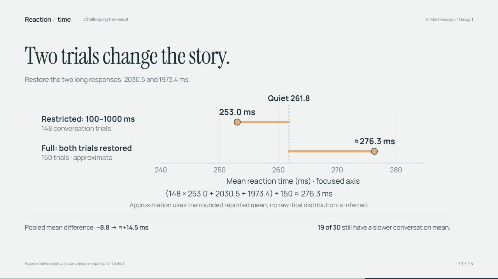
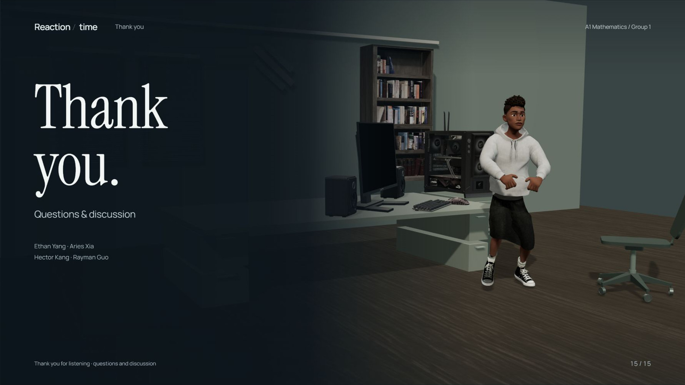

# Reaction Time · Mathematics

A fifteen-slide mathematics investigation with two appendices: a 3D student, a physical monitor-to-slide handoff, chart transformations and content-driven typography.

<!-- PROJECT-PREVIEW-START -->
## Scene gallery



**Animated 3D character study** · 11.2 s · saved development capture. The still gallery is below.



**[Watch / download the 22-second scene gallery](https://github.com/Rayman0106/reaction-time-math-3d-deck/releases/download/v2026.10.20/Reaction-Time-Scene-Gallery.mp4)** · 720p · silent · slideshow of saved project frames

| Distribution comparison | Checking the effect of exclusions |
| --- | --- |
|  |  |



These are saved scene screenshots; the gallery video crossfades between them. Download the final HTML for the current animated typography, transitions and dance. [Preview sources](docs/media/SOURCES.md).
<!-- PROJECT-PREVIEW-END -->

## Run or rebuild

```sh
python build.py
python tools/check.py
```

Python standard library only. Open the generated `index.html` in Edge or Chrome, wait for preparation, then click **Start**. The public toolbar has only previous, next and Slides.

Ready-made presentation and visual previews: [Releases](https://github.com/Rayman0106/reaction-time-math-3d-deck/releases/latest).

## Project layout

```text
src/       Presentation, camera, character, chart and typography source
assets/    Attributed models, fonts, charts and CC0 motion
vendor/    Pinned Three.js and Splitting.js with licences
tools/     Integrity checks and selected deterministic QA
docs/      Gallery, architecture, attribution and speaker notes
build.py   Offline HTML build entry point
```

The repository root contains entry points and project metadata. Old diagnostics, revision logs and redundant development captures are retained in the private original archive rather than mixed into this file list.

## Licence and assets

Application code is **MIT**. [Third-party notices](THIRD_PARTY_NOTICES.md) define the separate asset licences.

The public source packages CC0 character motion. The classroom edition’s optional Mixamo dance is separately licensed and excluded from raw source distribution; see [licensing scope](THIRD_PARTY_NOTICES.md). The complete original project and development history are preserved in a private archive.
